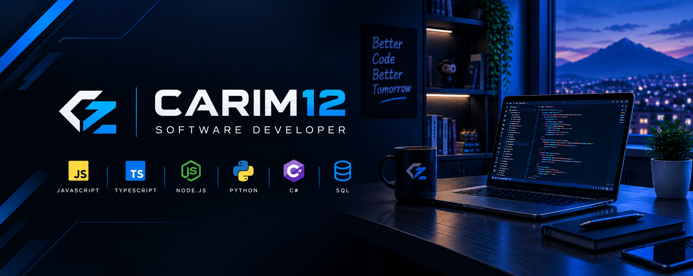

<!---->

# 👋 Hola, soy Carim

  
### Software Developer · Web & Backend

Perfil orientado al Desarrollo de Software, con interés en desarrollo web y backend. Cuento con conocimientos en programación, APIs REST, Node.js y bases de datos. Me caracterizo por mi  aprendizaje autodidacta, pensamiento lógico y capacidad para resolver problemas. Valoro la responsabilidad, perseverancia y mejora continua. Busco aportar mis conocimientos en proyectos tecnológicos y continuar desarrollándome profesionalmente.

## 🚀 Sobre mí

* 💻 Enfocado en **desarrollo web y backend**
* 🔧 Interesado en **APIs REST y desarrollo de aplicaciones**
* 🧠 Aprendiendo y fortaleciendo mis conocimientos constantemente
* 🗄️ Experiencia trabajando con **bases de datos MySQL**
* 🌱 Actualmente profundizando en **Node.js y desarrollo backend**

## 🛠️ Tecnologías

### Lenguajes

`JavaScript` · `TypeScript` · `Python` · `C#`

### Desarrollo

`Node.js` · `Express` · `ASP.NET` · `APIs REST`

### Bases de datos

`MySQL` · `SQL Server`

### Herramientas

`Git` · `GitHub` · `VS Code` · `Visual Studio`

## 📌 Proyectos destacados

### 🔹 REST API — Agencia de Viajes

API REST desarrollada como proyecto de práctica utilizando **Node.js, Express y MySQL**.

Incluye operaciones CRUD y trabajo con una base de datos para gestionar la información de una agencia de viajes.

**Tecnologías:** Node.js · Express · JavaScript · MySQL

[🔗 Ver repositorio](https://github.com/Carim2611/rest-api-senati)

### 🔹 CineStar MVC

Aplicación web desarrollada utilizando **C# y ASP.NET MVC**, aplicando el patrón de arquitectura MVC.

**Tecnologías:** C# · ASP.NET MVC · SQL Server

[🔗 Ver repositorio](https://github.com/Carim2611/webCinestar_MVC)

### 🔹 CineStar WebForms

Aplicación web desarrollada utilizando **ASP.NET Web Forms**, trabajando con la lógica de la aplicación y conexión con base de datos.

**Tecnologías:** C# · ASP.NET Web Forms · SQL Server

[🔗 Ver repositorio](https://github.com/Carim2611/webCinestar_WebForms)

## 📚 Actualmente aprendiendo

* 🔹 Desarrollo backend con **Node.js**
* 🔹 Diseño y desarrollo de **APIs REST**
* 🔹 Manejo de **bases de datos**
* 🔹 Nuevas herramientas y tecnologías para el desarrollo de software

## 🎯 Intereses

💻 Desarrollo web
⚙️ Backend
🔌 APIs y servicios web
🗄️ Bases de datos
🤖 Inteligencia artificial
🎮 Desarrollo de videojuegos

## 📫 Contacto

[LinkedIn](https://pe.linkedin.com/in/carim-estrada-espinal) · [GitHub](https://github.com/Carim2611)
